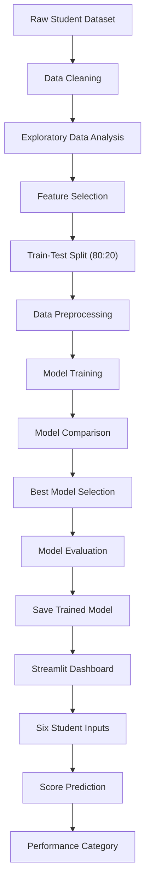

# 🎓 Student Academic Performance Prediction System

A Machine Learning-based web application that predicts students' final academic scores using academic, study-related and engagement factors.

## 📌 Project Overview

The Student Academic Performance Prediction System estimates a student's final academic score based on attendance, internal marks, assignment performance, previous semester scores, daily study hours and engagement level.

The system uses Machine Learning regression algorithms and provides predictions through an interactive Streamlit dashboard.

## ✨ Key Features

- Predicts final academic scores on a scale of 0–100.
- Uses six input features, including student engagement level.
- Displays student performance categories.
- Interactive Streamlit dashboard.
- Dataset cleaning and exploratory data analysis.
- Comparison of multiple Machine Learning models.
- Model evaluation using MAE, RMSE and R² Score.
- Actual vs Predicted visualization.
- Residual analysis.
- Feature importance analysis.

## 🛠️ Technologies Used

| Technology | Purpose |
|---|---|
| Python | Main programming language |
| Pandas | Data processing |
| Scikit-learn | Machine Learning |
| Matplotlib | Data visualization |
| Joblib | Model saving and loading |
| Streamlit | Web application |

## 📂 Project Structure

```text
Student_Performance_Prediction/
│
├── app.py
├── requirements.txt
├── README.md
├── .gitignore
│
├── data/
│   ├── raw/
│   └── processed/
│
├── models/
│   ├── best_model_academic.pkl
│   └── best_model_academic_with_engagement.pkl
│
├── reports/
│   ├── academic_model_comparison.csv
│   ├── academic_model_comparison_with_engagement.csv
│   └── figures/
│
└── src/
    ├── analyze_data.py
    ├── clean_data.py
    ├── evaluate_model.py
    ├── feature_analysis.py
    └── train_academic_model.py
```

## 📊 Dataset Description

The project uses a student academic performance dataset containing 5,010 original records.

After removing duplicate and invalid records and handling missing values, 4,980 records remain.

### Dataset Source

The dataset was obtained from a public GitHub repository:

[Student Academic Performance Forecasting Dataset](https://github.com/Raghulkumar2210/student-academic-performance-forecasting)

The original data provenance and collection methodology have not been independently verified.

### Input Features

1. Attendance Percentage
2. Internal Marks
3. Assignment Score
4. Previous Semester Score
5. Study Hours Per Day
6. Engagement Level

### Prediction Target

**Final Academic Score (0–100).**

### Data Preprocessing

The following operations were performed:

- Removed duplicate records.
- Identified and handled invalid numerical values.
- Handled missing numerical values using median imputation.
- Handled missing categorical values using mode imputation.
- Applied StandardScaler to numerical features.
- Applied OneHotEncoder to the categorical Engagement Level feature.

## 🤖 Machine Learning Models

Three regression algorithms were evaluated:

- Linear Regression
- Random Forest Regressor
- Gradient Boosting Regressor

**Selected Model: Linear Regression**

The model with the lowest RMSE was selected using the held-out test dataset.

### Model Comparison

| Model | MAE | RMSE | R² Score |
|---|---:|---:|---:|
| Linear Regression | 4.15 | 5.24 | 0.6691 |
| Gradient Boosting | 4.30 | 5.41 | 0.6471 |
| Random Forest | 4.50 | 5.69 | 0.6098 |

## 📈 Model Evaluation

| Metric | Result |
|---|---:|
| MAE | 4.15 |
| RMSE | 5.24 |
| R² Score | 0.6691 |

The model explains approximately 66.91% of the variation in final academic scores on the held-out test set.

- **MAE:** Average absolute difference between predicted and actual scores.
- **RMSE:** Measures prediction errors while giving larger errors more weight.
- **R² Score:** Indicates how much variation in the target is explained by the model.

### Feature Importance

The model uses standardized numerical coefficients and one-hot encoded engagement categories to examine feature relationships.

Internal Marks had the largest absolute coefficient among the individual encoded features. Engagement categories also showed notable relationships with predicted academic scores.

These coefficients describe associations learned by the model, not causal effects.

## 🚀 Installation and Setup

### 1. Clone the repository

```bash
git clone https://github.com/armankumar12-git/Student-Academic-Performance-Prediction.git
```

### 2. Open the project folder

```bash
cd Student-Academic-Performance-Prediction
```

### 3. Install dependencies

```bash
pip install -r requirements.txt
```

### 4. Run the application

```bash
python -m streamlit run app.py
```

The application will open in your browser.

## 🔮 Future Scope

- Integration of larger and independently verified academic datasets.
- Support for multiple semesters.
- Improved model performance through additional features and validation.
- Student performance trend analysis.
- Personalized academic improvement recommendations.

## ⚠️ Limitations

- Predictions are estimates, not guaranteed academic outcomes.
- The dataset's original provenance and collection methodology have not been independently verified.
- The dataset may not represent all institutions, courses or student populations.
- Model evaluation currently uses a single 80:20 train-test split.
- The reported metrics should not be interpreted as guaranteed real-world accuracy.
- Feature importance indicates relationships, not causation.

## 👨‍💻 Developer

**Arman Kumar**  
Bachelor of Computer Applications (BCA)

## 📄 License

This project is developed for academic and educational purposes.

## 🏗️ System Architecture


