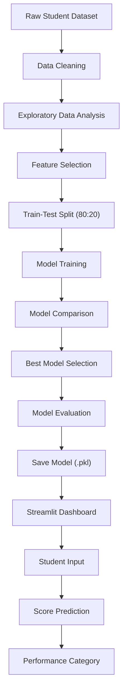

# 🎓 Student Academic Performance Prediction System

A Machine Learning-based web application that predicts students' final academic scores using academic and study-related factors.

## 📌 Project Overview

The Student Academic Performance Prediction System is designed to estimate a student's final academic score based on attendance, internal marks, assignment performance, previous semester scores, and daily study hours.

The system uses Machine Learning regression algorithms and provides predictions through an interactive Streamlit dashboard.

## ✨ Key Features

- Predicts final academic scores on a scale of 0–100.
- Displays student performance categories.
- Interactive Streamlit dashboard.
- Dataset analysis and visualization.
- Comparison of multiple Machine Learning models.
- Model evaluation using MAE, RMSE, and R² Score.
- Actual vs Predicted visualization.
- Residual analysis.

## 🛠️ Technologies Used

| Technology | Purpose |
|---|---|
| Python | Main programming language |
| Pandas | Data processing |
| Scikit-learn | Machine Learning |
| Matplotlib | Data visualization |
| Joblib | Model saving and loading |
| Streamlit | Web application |

## 📂 Project Structure

```text
Student_Performance_Prediction/
│
├── app.py
├── requirements.txt
├── README.md
├── .gitignore
│
├── data/
│   ├── raw/
│   └── processed/
│
├── models/
│   └── best_model_academic.pkl
│
├── reports/
│   ├── academic_model_comparison.csv
│   └── figures/
│
└── src/
    ├── analyze_data.py
    ├── clean_data.py
    ├── evaluate_model.py
    ├── feature_analysis.py
    └── train_academic_model.py
```

## 📊 Dataset Description

The project uses a student academic performance dataset containing 5,010 original records.

After removing duplicate and invalid records and handling missing values, 4,980 records remain.

### Input Features

1. Attendance Percentage
2. Internal Marks
3. Assignment Score
4. Previous Semester Score
5. Study Hours Per Day

### Prediction Target

Final Academic Score (0–100).

The dataset is sourced from a public GitHub repository. Its original provenance has not been independently verified.

## 🤖 Machine Learning Models

The following regression algorithms were evaluated:

- Linear Regression
- Random Forest Regressor
- Gradient Boosting Regressor

**Selected Model:** Linear Regression

It achieved the lowest RMSE among the three evaluated models on the test set.

## 📈 Model Evaluation

| Metric | Result |
|---|---:|
| MAE | 4.68 |
| RMSE | 5.90 |
| R² Score | 0.5798 |

The model achieved an R² score of approximately 0.58 on the held-out test set.

## 🚀 Installation and Setup

### 1. Clone the repository

```bash
git clone YOUR_GITHUB_REPOSITORY_URL
```

### 2. Open the project folder

```bash
cd Student_Performance_Prediction
```

### 3. Install dependencies

```bash
pip install -r requirements.txt
```

### 4. Run the application

```bash
python -m streamlit run app.py
```

The application will open in your browser.

## 🔮 Future Scope

- Integration of larger and verified academic datasets.
- Support for multiple semesters.
- Improved model performance through additional features and validation.
- Student performance trend analysis.
- Personalized academic improvement recommendations.

## ⚠️ Limitations

- Predictions are estimates, not guaranteed academic outcomes.
- Model performance depends on the quality and representativeness of the dataset.
- The current dataset's provenance has not been independently verified.
- The model has been evaluated using a single train-test split.

## 👨‍💻 Developer

**Arman Kumar**  
Bachelor of Computer Applications (BCA)

## 📄 License

This project is developed for academic and educational purposes.


## 🏗️ System Architecture

